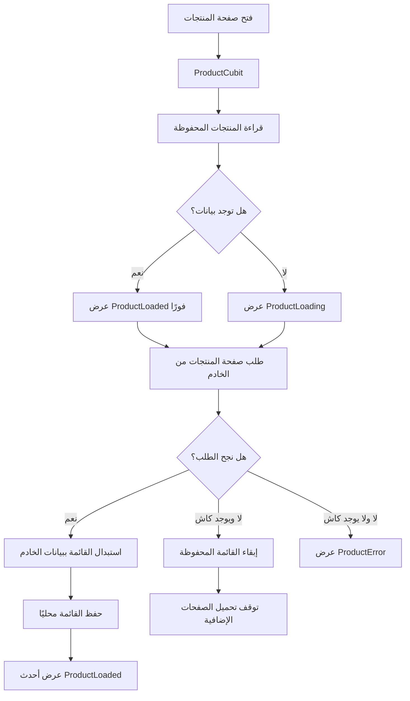

# شرح التخزين المحلي المؤقت للمنتجات

هذا الدليل يشرح كيف يحتفظ التطبيق بآخر قائمة منتجات تم تحميلها، ويعرضها بسرعة عند فتح الصفحة، ثم يحاول تحديثها من الشبكة.

## الفكرة

بدل أن تبدأ الصفحة فارغة وتنتظر استجابة الخادم في كل مرة:

1. نقرأ آخر قائمة محفوظة على الجهاز.
2. نعرضها مباشرة إذا كانت موجودة.
3. نطلب أحدث المنتجات من الشبكة.
4. عند نجاح الطلب، نستبدل القائمة القديمة بالجديدة ونحفظها محليًا.
5. عند فشل الشبكة، نبقي القائمة المحفوظة ظاهرة.

هذا الأسلوب يسمى **Cache-First مع تحديث من الشبكة** أو **Stale-While-Revalidate**: نعرض نسخة قد تكون قديمة قليلًا، وفي الوقت نفسه نحاول تحديثها.

## تدفق البيانات



## ترتيب الشرح للطلاب

### 1. ابدأ بالمشكلة

اسأل الطلاب: ماذا يرى المستخدم إذا فتح صفحة المنتجات دون إنترنت؟ قبل الكاش، غالبًا يرى مؤشر تحميل ثم خطأ، مع أن التطبيق سبق أن حمّل المنتجات من قبل.

### 2. وضّح مكان كل مسؤولية

- `ProductCubit` ينسّق الترتيب: قراءة الكاش، إصدار حالات الواجهة، طلب الشبكة، ثم حفظ النتيجة.
- `GetProductsListUsecase` يعرّف عمليات جلب القائمة وقراءة الكاش وحفظه.
- `ProductRepository` يقدّم واجهة موحدة للمنطق، و`ProductRepositoryImpl` يربط المصدر المحلي بالمصدر البعيد.
- `ProductLocalDataSource` مسؤول عن قراءة وكتابة المنتجات على الجهاز.
- `ProductModel` يحوّل المنتج بين كائن Dart وبيانات JSON.

### 3. اشرح التخزين المحلي

في [product_local_data_source.dart](../lib/app/features/home/data/data_source_local/product_local_data_source.dart) نستخدم `SharedPreferences` ونحفظ القائمة كنص JSON تحت المفتاح `cached_products_v1`.

التسلسل هو تحويل قائمة المنتجات إلى JSON قبل التخزين. وعند القراءة نفك JSON ثم ننشئ `ProductModel` لكل عنصر. إذا كان النص المحفوظ تالفًا أو لا يمكن قراءته، نحذف القيمة التالفة ونعيد قائمة فارغة بدل تعطيل الصفحة.

### 4. اشرح سبب وجود ProductModel

`SharedPreferences` يخزن قيمًا بسيطة مثل النصوص والأرقام، وليس كائنات Dart مباشرة. لذلك يحوّل [product_model.dart](../lib/app/features/home/data/models/product_model.dart) المنتج باستخدام `toJson()` و`fromJson()`.

لاحظوا أن بيانات `createdAt` و`updatedAt` واسم الفئة والعلامة التجارية محفوظة أيضًا، حتى لا تختفي عند استعادة المنتج من الكاش.

### 5. تتبّع بداية التحميل

في [product_cubit.dart](../lib/app/features/home/logic/cubit/product_cubit.dart)، عند طلب الصفحة الأولى:

1. يقرأ Cubit القائمة المحلية.
2. إذا وجد منتجات، يصدر `ProductLoaded` فورًا، فتظهر القائمة.
3. إذا لم يجدها، يصدر `ProductLoading`.
4. في الحالتين يطلب الصفحة الأولى من الشبكة.

عند نجاح الشبكة، تُمسح القائمة الموجودة في الذاكرة إذا كنا ما زلنا في الصفحة الأولى، ثم توضع بيانات الخادم مكانها. هذا مهم حتى لا تتكرر منتجات الكاش مع المنتجات الجديدة.

### 6. اربط ذلك بالصفحات الإضافية

إذا نجح طلب صفحة لاحقة، تُضاف منتجاتها إلى القائمة بدل استبدالها، ثم تُحفظ القائمة المجمعة مرة أخرى. بذلك يصبح الكاش هو آخر قائمة كاملة وصل إليها المستخدم، لا الصفحة الأولى فقط.

### 7. اشرح حالات الفشل

- إذا نجح الخادم: تظهر البيانات الجديدة ويُحدّث الكاش.
- إذا فشل الخادم وكان هناك كاش: تبقى المنتجات المحفوظة ظاهرة.
- إذا فشل الخادم ولم يوجد كاش: تصدر حالة `ProductError` وتعرض الواجهة الخطأ.
- إذا فشل حفظ الكاش: لا يتوقف عرض المنتجات، لأن فشل التخزين المحلي لا يجب أن يلغي نجاح طلب الشبكة.

## تجربة عملية داخل الصف

1. شغّل التطبيق مع اتصال إنترنت وافتح صفحة المنتجات.
2. انتظر ظهور المنتجات، ثم أغلق التطبيق بالكامل.
3. افصل الإنترنت وافتح التطبيق مجددًا.
4. لاحظ أن المنتجات المحفوظة تظهر، ثم لا تختفي عند فشل الاتصال.
5. أعد الاتصال بالإنترنت وافتح الصفحة أو حدّثها؛ يجب أن تستبدل البيانات المحلية بأحدث قائمة.
6. مرّر الصفحة لتحميل صفحات إضافية، ثم أعد التجربة دون إنترنت وتحقق من بقاء القائمة التي وصلت إليها.

## الاختبار

في [product_cache_test.dart](../test/product_cache_test.dart) نستخدم `SharedPreferences.setMockInitialValues({})` حتى يعمل الاختبار على تخزين وهمي بدل إعدادات الجهاز الحقيقية.

الاختبار يحفظ منتجًا، يقرأه مرة أخرى، ثم يقارن JSON قبل التخزين وبعد الاستعادة. شغّله بالأمر:

```powershell
flutter test test/product_cache_test.dart
```

هذا الاختبار يتحقق من التسلسل والتخزين المحلي. أما تجربة انقطاع الشبكة كاملة فتحتاج اختبارًا منفصلًا لـ`ProductCubit` مع Repository وهمي.

## أسئلة للنقاش

- لماذا نعرض الكاش قبل انتظار الشبكة؟
- لماذا نحفظ JSON بدل حفظ كائن `ProductEntity` مباشرة؟
- لماذا نستبدل القائمة عند الصفحة الأولى، ونضيف المنتجات عند الصفحات التالية؟
- ماذا يجب أن يحدث إذا كانت البيانات المحفوظة غير صالحة؟
- كيف نضيف وقتًا لانتهاء صلاحية الكاش؟
- هل `SharedPreferences` مناسب إذا أصبحت لدينا آلاف المنتجات؟ متى ننتقل إلى SQLite أو قاعدة محلية مثل Drift؟

## حدود التطبيق الحالي

- الكاش مخصص لقائمة التصفح والصفحات التي تم تحميلها. نتائج البحث والتفاصيل والمفضلة ليست ضمنه.
- لا يوجد وقت انتهاء صلاحية؛ أي أن آخر قائمة محفوظة تُستخدم حتى تتوفر استجابة شبكة أحدث.
- `SharedPreferences` مناسب لكمية بيانات صغيرة وبسيطة. قاعدة بيانات محلية أنسب إذا كبر حجم البيانات أو احتجنا بحثًا وفرزًا محليين.
